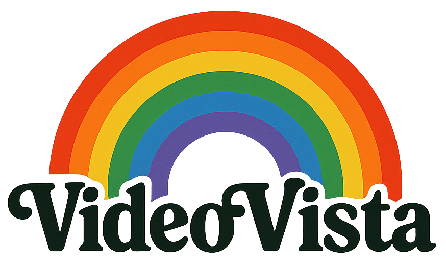

<div align="center">
  
</div>

#  VideoVista Family


<a src="https://img.shields.io/badge/cs.CV-2406.11303-b31b1b?logo=arxiv&logoColor=red" href="https://arxiv.org/abs/2406.11303"> 
</a> 
<a src="https://img.shields.io/badge/cs.CV-2406.11303-b31b1b?logo=arxiv&logoColor=red" href="https://arxiv.org/abs/2504.17821"> 
</a>
[](https://huggingface.co/collections/HIT-TMG/lychee-videovista)

If you appreciate our project, please consider giving us a star ⭐ on GitHub to stay updated with the latest developments.

## 🔥 News

**`2025.01.16`**  We have open-sourced the second version of the fully manually annotated video intelligence evaluation benchmark. [VideoVista-Benchmark B](https://huggingface.co/datasets/HIT-TMG/VideoVista-2)

**`2025.12.11`** 🚀 We have open-sourced the video long chain-of-thought reasoning data for cold-start reinforcement learning, available at [Video-CoTs](https://huggingface.co/datasets/HIT-TMG/VideoVista-CoTs)

**`2025.11.17`** 🚀 We have partnered with Huawei Cloud to launch the first VideoVista Video Understanding and Reasoning Competition. Everyone is welcome to sign up! For more details, see [VideoVista-Competition](https://github.com/HITsz-TMG/VideoVista/tree/main/VideoVista-Competition)

**`2025.04.23`** 🚀 We release VideoVista-CulturalLingo, the first video evaluation benchmark designed to bridge cultural, linguistic, and domain divide in video comprehension. You can download this benchmark from [HuggingFace](https://huggingface.co/datasets/Uni-MoE/VideoVista-CulturalLingo).

**`2025.04.13`** 🎉 We move the previous VideoVista from [Uni-MoE](https://github.com/HITsz-TMG/UMOE-Scaling-Unified-Multimodal-LLMs) to here. It contains the [VideoVista (Evaluation), VideoVista-Train (Instruction Tuning), VideoVista-Event (Pertaining)](https://huggingface.co/collections/Uni-MoE/videovista-67f397b7eddc81cb207228a2). Detailed content is [here](https://github.com/HITsz-TMG/VideoVista/tree/main/VideoVista).


## :page_facing_up: Citation
If you find this project useful in your research, please consider cite:
```bibtex
@ARTICLE{videovista_2,
  author={Li, Yunxin and Chen, Xinyu and Xu, Zhenran and Wang, Qi and Ma, Yicheng and Liu, Jin and Chen, Kai and Pan, Youcheng and Ding, Yuxin and Wang, Zhefeng and Huai, Baoxing and Hu, Baotian and Zhang, Min},
  journal={IEEE Transactions on Pattern Analysis and Machine Intelligence}, 
  title={VideoVista: Benchmarking Diverse and Complex Video-Language Interaction for MLLMs}, 
  year={2026},
  volume={},
  number={},
  pages={1-10},
  keywords={Video Question Answering;Video Evaluation Benchmarks;Video Understanding and Reasoning;Multimodal LLMs},
  doi={10.1109/TPAMI.2026.3741941}}

@article{li2024videovista,
  title={Videovista: A versatile benchmark for video understanding and reasoning},
  author={Li, Yunxin and Chen, Xinyu and Hu, Baotian and Wang, Longyue and Shi, Haoyuan and Zhang, Min},
  journal={arXiv preprint arXiv:2406.11303},
  year={2024}
}

@article{chen2025videovista,
  title={VideoVista-CulturalLingo: 360$\^{}$\backslash$circ $ Horizons-Bridging Cultures, Languages, and Domains in Video Comprehension},
  author={Chen, Xinyu and Li, Yunxin and Shi, Haoyuan and Hu, Baotian and Luo, Wenhan and Wang, Yaowei and Zhang, Min},
  journal={arXiv preprint arXiv:2504.17821},
  year={2025}
}
```
